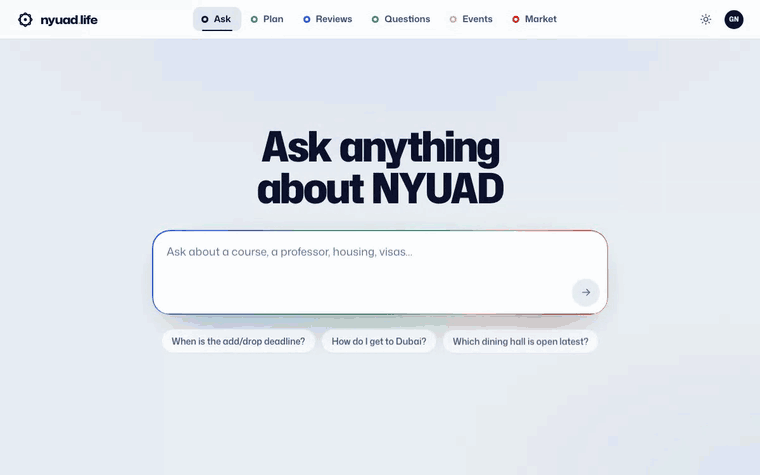
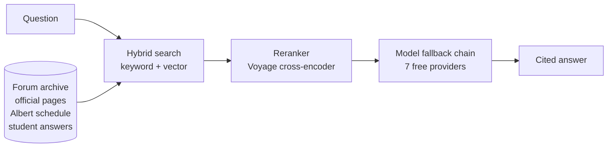

# nyuad.life

Answers for NYU Abu Dhabi students, cited from 13,000+ student forum threads, official university pages and the class
schedule. Live at **[nyuad.life](https://nyuad.life)** (NYU sign-in required).

[](https://nyuad.life)

<sub>Forum snippets and a person's name are blurred: the archive is only for signed-in students.</sub>

## What it does

- **Ask.** A question is answered from the Room of Requirement forum archive, official NYUAD pages, the Albert class
  schedule and answers other students wrote here, with numbered citations and a confidence level. Under the latest
  answer, one tap asks other students; their answers appear under the question and in the asker's history, and
  become sources for Ask. Thumbs, reports and questions put to students show in the admins' Ask log. Students likely to know see a "can you answer?" card on the Ask home page.
- **Plan.** One box: "calc, intro to CS, any Arts Core, nothing before 10, Fridays off" becomes clash-free weeks to
  swipe through, ranked by how students rate the professors and courses. What it understood shows as removable chips,
  and "move the lab to Tuesday" or "no 9am" changes the plan.
- **Reviews.** Every NYU Abu Dhabi course and professor in Albert's schedule, summarised from every forum post and
  comment about them (read offline into one digest each) and reviews students wrote here. Courses get stars and a
  score; professors never do: students review them in words, about what their classes are like (how hard the A is, the
  workload, the exams), never whether they are good or bad.
- **Independent.** A student project, not affiliated with or endorsed by NYU Abu Dhabi; the login screen and Settings
  say so.
- **Events and Market.** Campus events, things for sale, Falcon and Campus Dirham trades, and shared rides.

## How an answer is made



The question, its rewrites and campus aliases are searched together with keyword and vector retrieval (Voyage
`voyage-3.5`). Voyage's `rerank-2.5` cross-encoder then drops threads that do not fit, so an answer is not padded with
unrelated posts. The answer is written by the first model that is free right now in a chain of seven providers (Z.ai,
Gemini, Groq, Cloudflare, OpenRouter, Mistral, Vercel AI Gateway); one that is overloaded or out of quota rests while
the next one answers, and a question asked again within six hours is answered from a cache. That keeps the site free
to run. Students can also sign in with ChatGPT and have their answers run on their own plan. The whole chain, the keys
and the deploy steps are in [docs/DEPLOY.md](docs/DEPLOY.md).

## Data and privacy

- **Where the data comes from.** The archive is posts and comments from the Room of Requirement, the NYU Abu Dhabi
  student Facebook group, read by `scripts/scrape.ts` from the group as a member sees it. Official pages
  (`data/official.jsonl`) and the Albert class schedule (`data/classes.jsonl`) are public university pages and stay in
  the repository.
- **Where it is kept.** The posts (`posts.jsonl`) and the search index built from them live in a private Vercel Blob
  store, never in git; the build pulls the index from there. Phone numbers and personal email addresses are taken out
  before anything is served.
- **Who sees it.** Only signed-in NYU Abu Dhabi students: an account needs a code sent to a `@nyu.edu` address, and
  the API refuses answers and archive browsing to anyone without one.
- **Removing your posts.** Email gnn9245@nyu.edu from your NYU address with a link to the post, or ask for everything
  you wrote, and it is taken out within a week. Removals are kept in `removed.json` in the private store (post ids and
  author names): `npm run archive -- pull posts`, add the entry to `data/removed.json`
  (`{"posts": ["<id>"], "authors": ["<name>"]}`), `npm run archive -- push removed`, then run the index workflow and
  deploy. A listed author's posts and comments are left out of every index from then on, even when the scraper reads
  them again.

## Run it locally

```bash
npm install
cp .env.example .env            # GEMINI_API_KEY at least
npm run dev                     # API on http://localhost:8787, serving dist/ when built
npx vite                        # web app with hot reload on http://localhost:5173
npm run check                   # typecheck, tests, production build
```

Without any model key the API still serves the course search and keyword search. The tests run the whole API against a fake
Gemini, the board schema against PGlite, and the scraper against a fake Facebook (skipped without Playwright's Chromium).

Deploying, scraping, indexing and admin mode are in [docs/DEPLOY.md](docs/DEPLOY.md).

## Tech

TypeScript throughout. React 19 and Vite for the web app, Vercel serverless functions for the API, Supabase Postgres
for accounts, questions put to students and reviews, Voyage AI for embeddings and reranking, and a private Vercel Blob store for the
archive and its index. Playwright drives the forum, Albert and official-page scrapers, Resend sends the NYU sign-in
codes, and GitHub Actions runs the weekly official-page crawl and the incremental re-indexing. Tests use Vitest with a
fake model and PGlite in place of the database.
